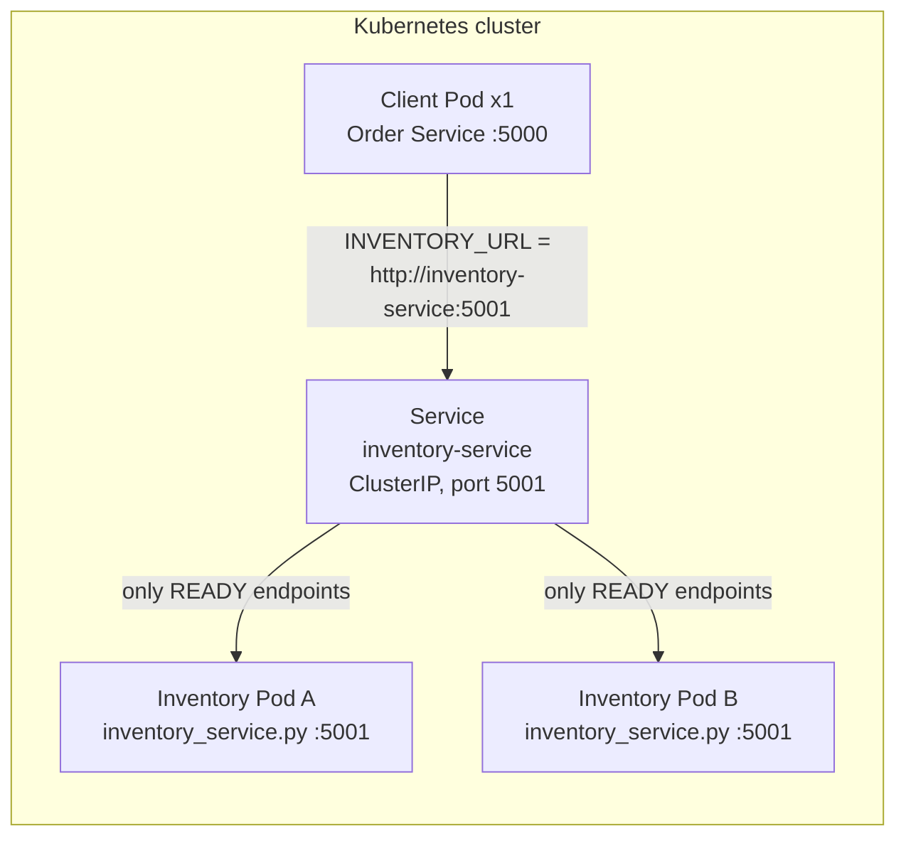
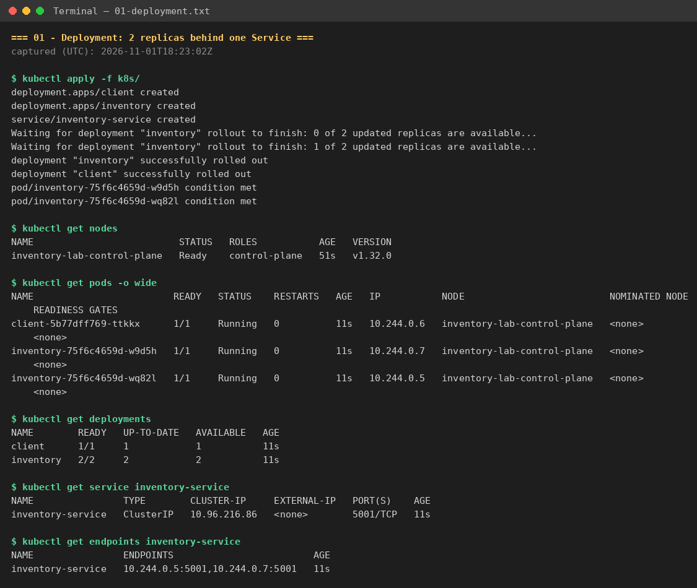
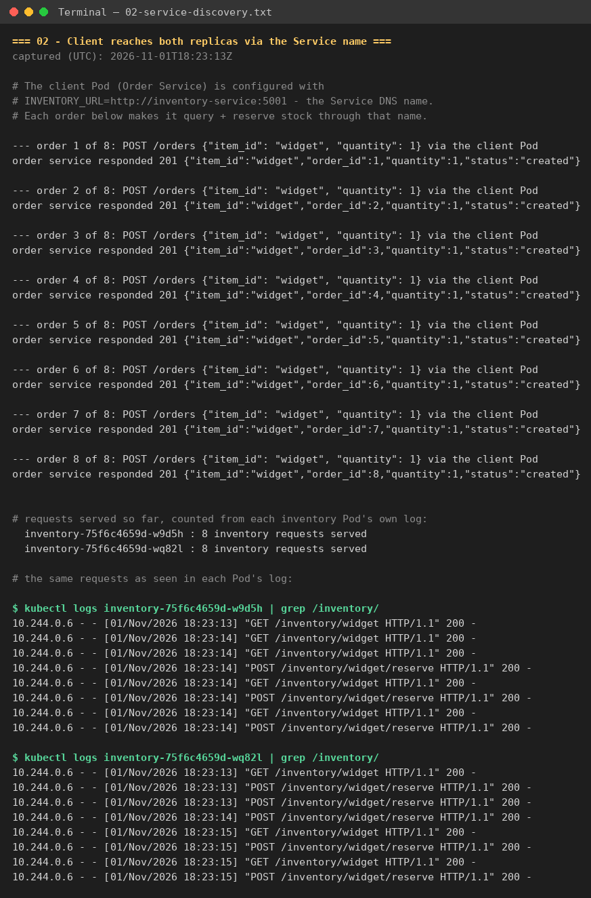
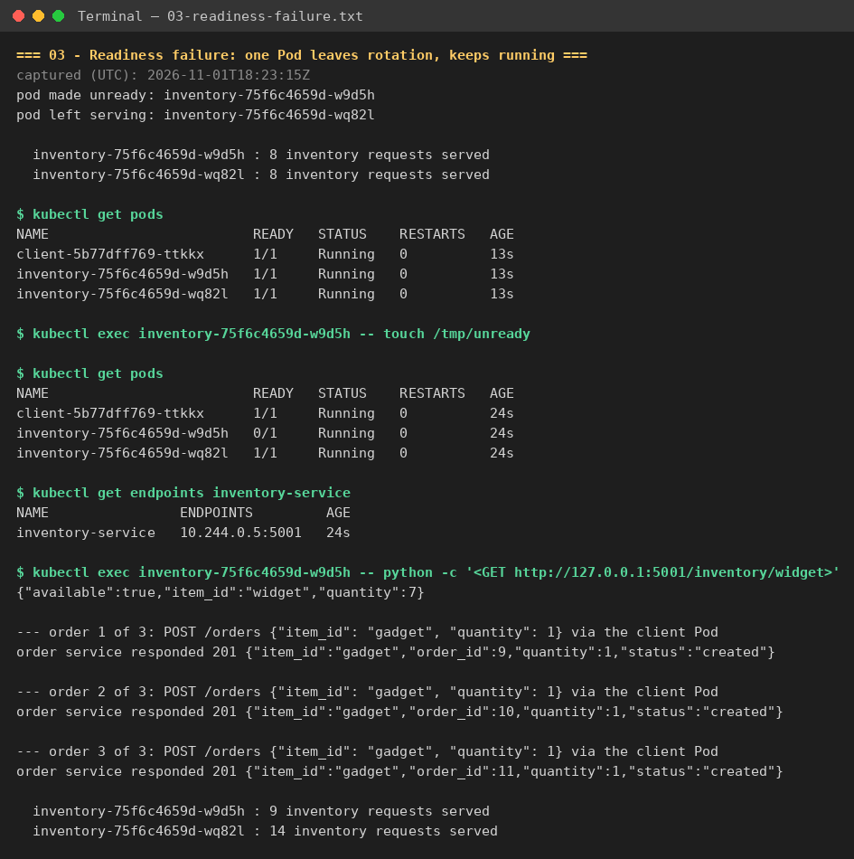
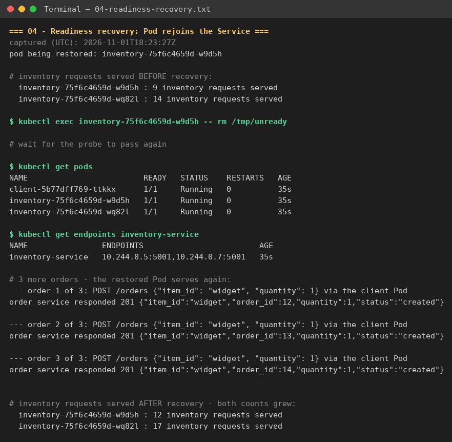
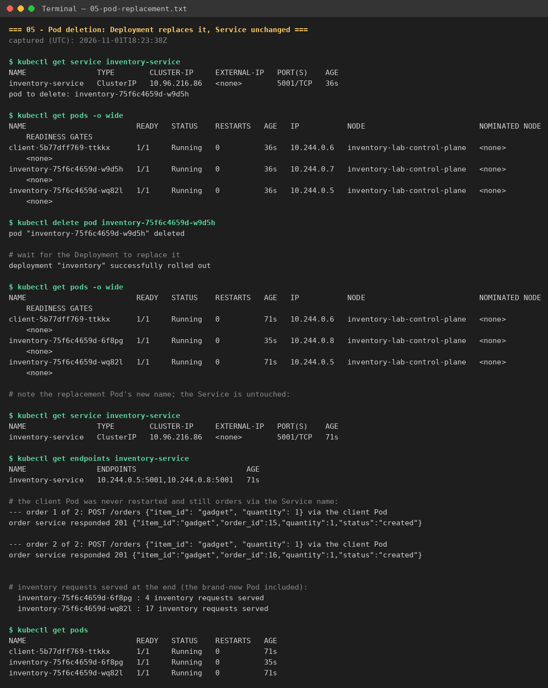

# Kubernetes Lab: Service Discovery, Readiness, and Pod Replacement

This lab takes the **Inventory Service** and its client, the **Order Service**,
from the Module 4 assignment (Architecture & Service Boundaries) and deploys
them on Kubernetes:

- **Inventory Service** — Deployment with **2 replicas**
- **Service** — one Kubernetes Service, `inventory-service`, in front of them
- **Client** — 1 Order Service Pod that talks to Inventory **only** through
  the Service DNS name, `http://inventory-service:5001`, never through
  individual Pod names or Pod IPs

The lab demonstrates three things:

1. Requests through the Service reach **both** Inventory replicas.
2. A Pod that fails its **readiness probe** stops receiving Service traffic
   while it keeps running, and rejoins when it recovers.
3. When a Pod is **deleted**, the Deployment creates a replacement with a new
   name, while the Service name and the client stay unchanged.

The evidence was captured on a [kind](https://kind.sigs.k8s.io/) cluster
(Kubernetes v1.32). The same manifests work unchanged on minikube and Docker
Desktop Kubernetes.

## Architecture



- **Inventory Service** (`inventory/inventory_service.py`) — the Module 4
  Flask service: `GET /inventory/<item_id>` checks availability and
  `POST /inventory/<item_id>/reserve` reserves stock. One change was made for
  this lab: `GET /health` — the readiness endpoint — returns **503 while a
  file named `/tmp/unready` exists inside the Pod**, so readiness can be
  failed on demand without stopping the process.
- **Service** (`k8s/inventory-service.yaml`) — a ClusterIP Service named
  `inventory-service` selecting `app: inventory`. Cluster DNS resolves that
  name, and the Service routes each connection to one of the *ready* Pod IPs
  in its endpoints.
- **Client** (`client/order_service.py`) — the Module 4 Order Service,
  unchanged. It reads `INVENTORY_URL` from the environment; the client
  Deployment sets it to `http://inventory-service:5001`. Every order makes it
  query availability and then reserve stock through that Service name (its
  notification call stays fire-and-forget, as in Module 4, and no Notification
  Service runs in this lab).

One honest consequence of reusing the Module 4 code: stock is in-memory and
per Pod, so each replica keeps its own count, exactly as the service behaved
when it ran as a single process. The request-distribution evidence below is
therefore measured in the Pods' own request logs rather than in stock levels.

## Prerequisites

- A local Kubernetes cluster: [kind](https://kind.sigs.k8s.io/), minikube, or
  Docker Desktop with Kubernetes enabled
- `kubectl`, and Docker (to build the two images)

## Deploy the application

```bash
# 1. Start a cluster (kind example)
kind create cluster --name inventory-lab

# 2. Build the images
docker build -t inventory-service:latest ./inventory
docker build -t inventory-client:latest  ./client

# 3. Load them into the cluster nodes
kind load docker-image inventory-service:latest --name inventory-lab
kind load docker-image inventory-client:latest  --name inventory-lab
# (minikube instead:  minikube image load inventory-service:latest
#                     minikube image load inventory-client:latest)

# 4. Deploy: Inventory Deployment (2 replicas) + Service + client
kubectl apply -f k8s/
kubectl rollout status deployment/inventory
kubectl rollout status deployment/client
```

## Test 1 — Both replicas receive requests through the Service

Place a few orders through the client's own API (each order makes the client
call Inventory twice through the Service name — one availability query and
one reservation), then count the requests in each Inventory Pod's own log:

```bash
kubectl get pods -o wide
kubectl get service inventory-service
kubectl get endpoints inventory-service

# place 8 orders from inside the client Pod
for i in $(seq 1 8); do
  kubectl exec deploy/client -- python -c "
import urllib.request, json
req = urllib.request.Request('http://127.0.0.1:5000/orders',
    data=json.dumps({'item_id': 'widget', 'quantity': 1}).encode(),
    headers={'Content-Type': 'application/json'})
print(urllib.request.urlopen(req, timeout=5).read().decode())"
done

# which Inventory Pods served those calls?
for p in $(kubectl get pods -l app=inventory -o jsonpath='{.items[*].metadata.name}'); do
  echo "$p:"; kubectl logs $p | grep -E '/inventory/'
done
```

Both Pods are `Running` with `READY 1/1`, the endpoints list both Pod IPs,
and **both** Pods' logs contain `GET /inventory/...` and
`POST /inventory/.../reserve` lines — in the captured run each Pod served
exactly 8 of the 16 Inventory calls. The client only ever dialed the Service
name, yet the requests were spread across both replicas.





Full terminal output: [evidence/01-deployment.txt](evidence/01-deployment.txt) ·
[evidence/02-service-discovery.txt](evidence/02-service-discovery.txt)

## Test 2 — Readiness failure and recovery

The Deployment gives every Inventory Pod a readiness probe:

```yaml
readinessProbe:
  httpGet: { path: /health, port: 5001 }
  initialDelaySeconds: 3
  periodSeconds: 3
  failureThreshold: 2
```

Because `/health` returns 503 while `/tmp/unready` exists in the Pod, one
Pod's readiness can be failed on demand without stopping or crashing it:

```bash
POD=$(kubectl get pod -l app=inventory -o jsonpath='{.items[0].metadata.name}')

# make the Pod fail readiness
kubectl exec $POD -- touch /tmp/unready
sleep 10
kubectl get pods                        # the Pod is 0/1 but still Running
kubectl get endpoints inventory-service # its IP is gone from the endpoints
# place more orders: every Inventory call now lands on the other Pod
# (check the per-Pod request counts in the Pods' logs, as in Test 1)

# restore readiness
kubectl exec $POD -- rm /tmp/unready
sleep 10
kubectl get pods                        # back to 1/1, IP back in the endpoints
```

In the captured run, the unready Pod receives no Service traffic at all: its
request count rises by exactly one — the direct in-Pod check shown in the
log — while all six Inventory calls from the three new orders land on the
ready Pod (8 → 14). The direct check also proves the unready Pod was alive
and serving the whole time; it was only removed from Service rotation.
After `rm /tmp/unready` it passes the probe again and its count grows once
more (9 → 12 over the next three orders, matched by the other Pod).





Full terminal output: [evidence/03-readiness-failure.txt](evidence/03-readiness-failure.txt) ·
[evidence/04-readiness-recovery.txt](evidence/04-readiness-recovery.txt)

## Test 3 — Pod deletion and replacement

```bash
kubectl get service inventory-service        # note the ClusterIP
POD=$(kubectl get pod -l app=inventory -o jsonpath='{.items[0].metadata.name}')
kubectl delete pod $POD
kubectl get pods -o wide                     # a replacement with a NEW name appears
kubectl get service inventory-service        # same name, same ClusterIP
```

The Deployment's replica count is a desired state: as soon as one Pod is
deleted, the ReplicaSet starts a replacement. The replacement has a different
name (and IP), the Service object is not touched at all, and the client Pod —
never restarted, still configured with only the Service name — keeps placing
orders without any change.



Full terminal output: [evidence/05-pod-replacement.txt](evidence/05-pod-replacement.txt)

## Cleanup

```bash
kubectl delete -f k8s/
kind delete cluster --name inventory-lab     # if you used kind
```

## Repository layout

```
inventory/inventory_service.py  Inventory Service (Module 4), /health readiness toggle added
inventory/Dockerfile
inventory/requirements.txt
client/order_service.py         client: Order Service (Module 4), unchanged
client/Dockerfile
client/requirements.txt
k8s/inventory-deployment.yaml   Deployment, 2 replicas, readiness probe
k8s/inventory-service.yaml      ClusterIP Service "inventory-service"
k8s/client-deployment.yaml      client Deployment (INVENTORY_URL = Service DNS name)
evidence/                       raw terminal output for every test above
screenshots/                    rendered screenshots of the same runs
```

## Reflection

A stable Service name is useful because Pods are disposable: they are deleted,
rescheduled, and replaced with new names and IP addresses, as the deletion test
shows, so any client that hardcoded a Pod address would break the first time a
Pod changed. The Service gives clients one permanent DNS name and ClusterIP to
talk to, while Kubernetes quietly keeps its endpoint list pointed at whichever
Pods currently exist and are ready. That indirection is also what makes
readiness useful — an unready Pod drops out of the endpoints and stops getting
traffic without the client noticing, then rejoins the same way when it recovers.
Together, the Service, the readiness probe, and the Deployment's self-healing
mean failures and replacements are absorbed by the platform instead of becoming
client outages.
